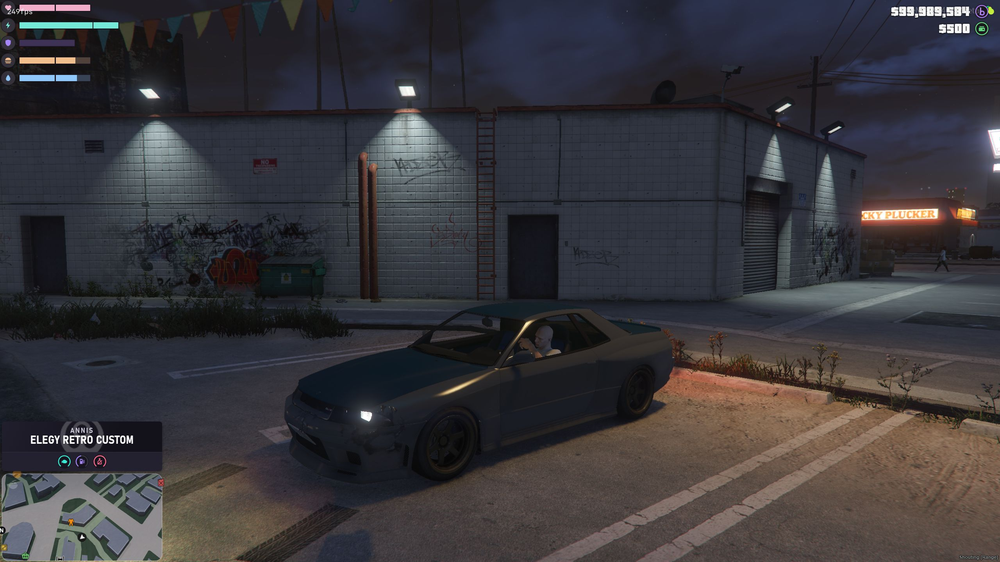
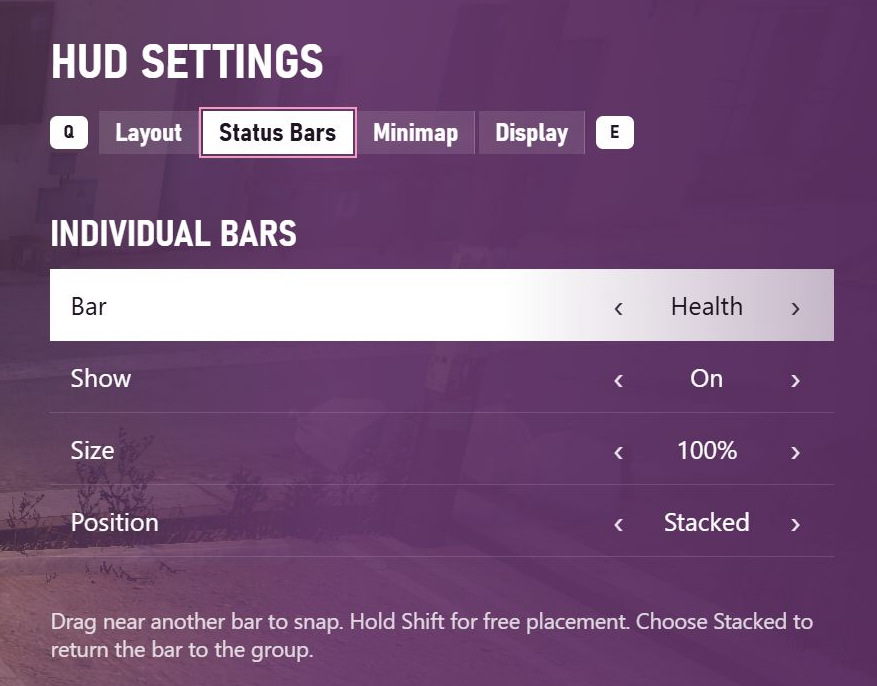
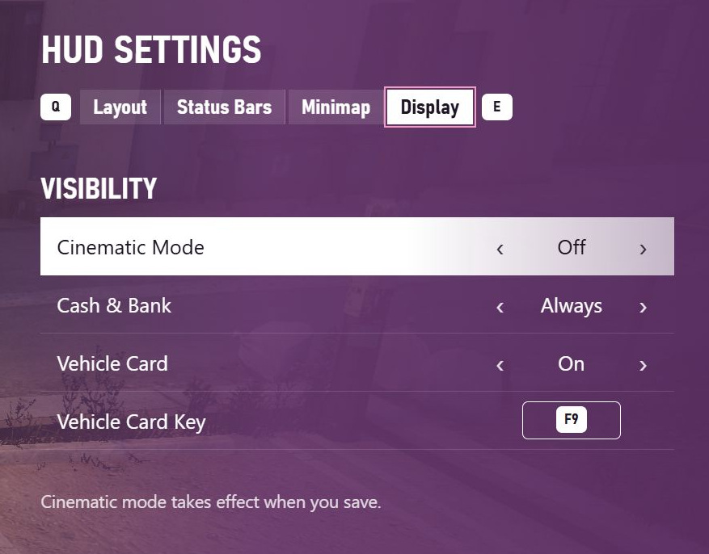
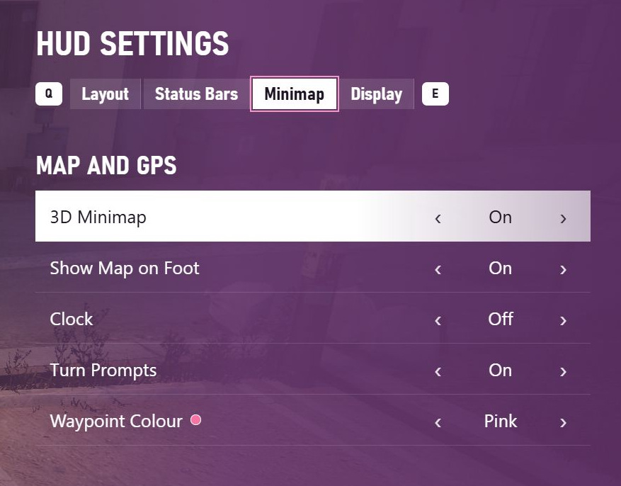
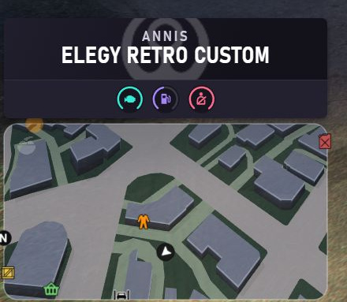

# Bakery HUD

Bakery HUD is a customizable FiveM HUD with a 3D minimap, turn-by-turn GPS, individual status bars, and a vehicle condition card. It supports QBox, QBCore, ESX Legacy, and standalone servers.

**[Download the latest release](https://github.com/TheMuffinMann324/bakery_hud/releases/latest)**

## Screenshots



| Status Bars | Display |
| --- | --- |
|  |  |

| Minimap settings | 3D minimap and vehicle card |
| --- | --- |
|  |  |

## Features

- **3D minimap and native 2D radar.** Switch renderers in game, show the map on foot, and toggle the clock. The 3D map renders buildings and follows supported blips and routes. The 2D radar takes over in interiors, outside the 3D coverage area, or when WebGL is unavailable.
- **Turn-by-turn GPS for personal and mission routes.** See the next turn and its distance for personal waypoints or mission and job blips routed with `SetBlipRoute`. Personal waypoints take priority. Pick pink, teal, violet, blue, amber, or GTA Default for your waypoint. Other blips keep their normal colours on the pause map.
- **Individually customizable status bars.** Show, hide, resize, and position health, stamina, armor, hunger, thirst, stress, and oxygen. Stress is off by default and oxygen appears underwater. Drag bars to snap into alignment or a neat vertical stack. Hold **Shift** for free placement.
- **Vehicle condition card.** See the condensed model name over a faded manufacturer emblem, with engine, fuel, and seatbelt indicators below. The card appears on entry and warns about major impacts, engine damage, and low fuel. Pin or dismiss it with a configurable key, **F7** by default.
- **Cash and bank display.** Show balances at all times, hold a configurable key to reveal them, or hide them. Balances, hunger, thirst, and stress use framework data when available.
- **HUD Settings and cinematic mode.** Use `/hudsettings` to move and resize the HUD and save preferences per player. Cinematic mode hides the HUD and radar during gameplay.
- **Mission objective exports.** Client scripts can show and clear on-screen objectives.

## Install

1. Download `bakery_hud.zip` from the [latest release](https://github.com/TheMuffinMann324/bakery_hud/releases/latest) and extract it into your server's `resources` folder. The ZIP contains the `bakery_hud` folder with a prebuilt UI and the streamed radar assets.
2. Disable other resources that control the radar or stream competing radar assets, such as `qbx_hud`, `qb-hud`, `gta6_hud`, or `gta6_minimap`. If a resource group starts a conflicting HUD, put its `stop` line after the group's `ensure` line. On ESX, you can disable the `esx_status` overlay and keep the status data.
3. Add `ensure bakery_hud` to `server.cfg` after the line that starts your framework or its resource group. Standalone servers can add the line directly.
4. Restart the server, or run `refresh` followed by `ensure bakery_hud` in the server console. After upgrading, players who were already connected should reconnect to reload the streamed assets.

When upgrading, back up your `config.lua`, remove the old `bakery_hud` folder, then extract the new one and reapply your config changes. Replacing the folder clears out superseded map files.

A QBox server that starts its resources as a group can use this order.

```cfg
ensure [qbx]
stop qbx_hud
ensure bakery_hud
```

## Configuration

Edit [`config.lua`](config.lua), then restart `bakery_hud`.

| Setting | What it controls |
| --- | --- |
| `Config.Framework` | `auto` checks QBox (`qbx_core`), QBCore (`qb-core`), and ESX Legacy (`es_extended`) in that order, then falls back to standalone. You can also set `qbox`, `qbcore`, `esx`, or `standalone` explicitly. |
| `Config.Bars` | Default enabled bars and their order. Players can enable or disable each bar in HUD Settings. Oxygen is visible only underwater. Hunger, thirst, and stress require live status data from the framework. On ESX, those statuses must be registered with `esx_status`. |
| `Config.ShowMoney`, `Config.Currency`, `Config.ESX` | Balance visibility, currency symbol, and ESX account names. Standalone mode shows the game-native stats without account balances. |
| `Config.Radar`, `Config.Map3D` | Minimap size, zoom, vehicle-only visibility, clock, and 3D building appearance. The 3D map samples GTA V collision near the player to refine building heights and caches those measurements on the client. |
| `Config.Navigation` | GPS prompt visibility, distance units, and the default personal waypoint colour. Set `waypointColor` to `false` to default to GTA’s stock waypoint. Prompts appear in vehicles by default. |
| `Config.Vehicle`, `Config.Commands` | Vehicle card key, alert thresholds, display duration, and settings command name. |

## Player controls

Use `/hudsettings` to open HUD Settings. Drag elements to move them, or use the tabs below to adjust display preferences.

In HUD Settings, **Q** and **E** switch tabs, the **arrow keys** navigate and adjust options, **Enter** saves, **R** resets to the server defaults, **H** hides or shows the settings panel, and **Esc** cancels.

- **Layout** moves or resizes the minimap, the status bar group, and balances. It also controls visibility for the whole status group.
- **Status Bars** controls each bar's visibility, size, and position. Drag near another bar to snap to its alignment or the standard stacking gap. Hold **Shift** for free placement. You can also adjust **Horizontal** and **Vertical** in **Custom** mode, or choose **Stacked** to return the bar to the group.
- **Minimap** controls the 3D renderer, map visibility on foot, clock, turn prompts, and personal waypoint colour. Choose **GTA Default** for the stock waypoint and route. The map can still show in vehicles when **Show Map on Foot** is off.
- **Display** controls cinematic mode, balance visibility, and the vehicle card. Set **Cash & Bank** to **Always**, **Hold Key**, or **Off**. In **Hold Key** mode, choose **Balance Key** and hold that key during gameplay to reveal both balances. Set **Vehicle Card Key** to change how you pin or dismiss the card while in a vehicle. The defaults are F10 for balances and F7 for the vehicle card. Both bindings accept letters, numbers, and F1–F12 except F8.

The options are saved per player. Cinematic mode hides Bakery HUD and the game's HUD and radar during gameplay. `/hudsettings` stays available in cinematic mode.

## Mission objectives

Call these exports from a client script. The optional second argument highlights the first matching phrase. The optional third argument sets the timeout in milliseconds.

```lua
exports.bakery_hud:SetObjective('Take the delivery to the marina', 'the marina', 12000)

-- Clear the objective when the player completes it.
exports.bakery_hud:ClearObjective()
```

## Build from source

The NUI uses React, TypeScript, and Vite. Open a terminal at the repository root and run these commands with Node.js 22.12+ or a newer LTS release.

```sh
cd web
npm ci
npm run build
```

The build writes to `web/dist`. Run `refresh` and `restart bakery_hud` in your server console to load the rebuilt UI.
